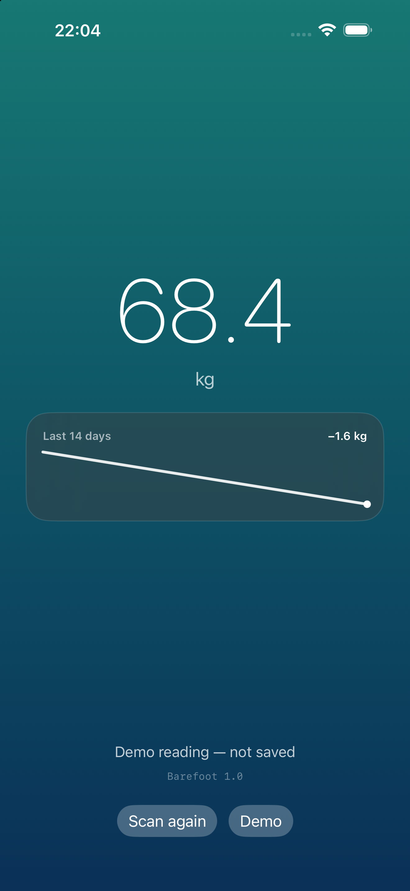
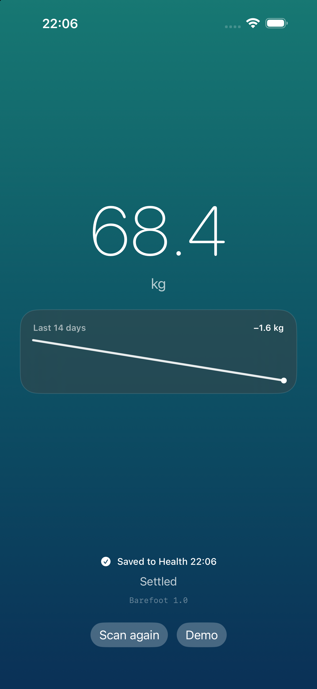

# Barefoot

[](LICENSE)

[github.com/krishantt/barefoot](https://github.com/krishantt/barefoot) · [privacy](https://krishantt.github.io/barefoot/privacy.html) · [support](https://krishantt.github.io/barefoot/support.html)

One screen, no account, no ads: listens for the scale, shows the weight, and saves
the settled reading to Apple Health. The OKOK app becomes unnecessary.

## Screenshots

| Reading + 14-day trend | Saved to Health |
|:---:|:---:|
|  |  |

Generated from the app itself with `-demo`, so they cannot drift from the code.

## How your scale actually talks

It is an **OKOK / Chipsea** scale (advertises as `Yoda1`). These scales never accept
a Bluetooth GATT connection — they **broadcast the weight inside the BLE
advertisement** and expose no usable service. So there is nothing to connect to:
the app just scans and decodes the frames.

Four frame layouts are handled, keyed by the manufacturer id in the advertisement:

| Variant | Company id | Frame |
|---|---|---|
| V20 | `0x20CA` | 19 bytes, settled flag + XOR checksum, weight and impedance |
| V11 | `0x11CA` | 23 bytes, unit and resolution packed in byte 9 |
| VF0 | `0xF0FF` | 4 bytes, plain weight |
| C0 | low byte `0xC0` | 13 bytes, stable flag + unit/resolution in byte 6 |

### Why no body-fat / muscle / water numbers

These scales measure weight plus **impedance**, so the vendor app derives body
composition from it: `impedance + height → total body water → fat-free mass →
body fat %`, then BMR and metabolic age off that.

This app does not do that, on purpose:

- It needs **height, age and sex**, which the app does not collect.
- Foot-to-foot scales are calibrated with **private per-device regressions**. The
  published equations (Kyle et al.) are for wrist-to-ankle measurement and read
  wrong here, so the numbers would not match the manufacturer's app.
- Typical error is ±3–5 percentage points even when done properly.
- Apple's HealthKit rules do not look kindly on writing estimated health data.

A confidently displayed "27.4% body fat" that is off by five points is worse than
no number. Weight is what the scale actually measures.

Only the settled frame is written (V20 and C0 carry a stable flag), and the same
weigh-in is not saved twice within 20 seconds.

The trend line is drawn from your last 14 days of weight in Apple Health — real
readings, not estimates. Impedance is deliberately ignored: see below.

## Build it

MIT licensed. Needs Xcode and a free Apple ID — free accounts sign for 7 days,
so re-run from Xcode to renew.

```bash
cd scaleweight
xcodegen generate
open Barefoot.xcodeproj
```

In Xcode:

1. **Xcode → Settings → Accounts → + → Apple ID** and sign in (2FA), then set
   `DEVELOPMENT_TEAM` in `project.yml` to your team id and re-run `xcodegen generate`
   (the committed one is the author's). Bump the bundle id if it is taken.
2. Plug in the iPhone, pick it as the run destination, press ▶.
3. First launch only: **Settings → General → VPN & Device Management** → trust the
   developer certificate.
4. Allow Bluetooth and Health access (Body Mass, **write** only).

## Use it

Open the app, step on the scale barefoot, wait for the green checkmark. History
lives in Health → Browse → Body Measurements → Weight.

The scale only advertises while it is measuring, so "no data yet" with the app
open is normal until you stand on it. The screen stays awake until a reading
lands, so it cannot lock mid-weigh-in.

Long-press the version label at the bottom to reveal the raw Bluetooth frame —
that is the hex to send if your scale's format is not recognised.

`xcrun simctl launch booted dev.krishtimil.Barefoot -demo` starts the app with a
sample reading and trend, for screenshots or a quick UI check.

## Re-signing (free account)

A free Apple ID signature lasts 7 days. One command rebuilds and reinstalls:

```bash
./scripts/resign.sh          # or alias resign=... in ~/.zshrc
```

It finds the connected iPhone itself, prints the new expiry date, and launches
the app.

## Distribution

- App Store: see `APPSTORE.md`
- AltStore PAL (EU / Japan / Brazil only): see `DISTRIBUTE.md`

`scripts/make_altstore_source.py` generates the AltStore source JSON from a real
build, including the entitlements and privacy strings AltStore validates against
the IPA.

## Contributing

The protocol surface is one file. `Barefoot/OkokPacket.swift` has no Bluetooth or
UI imports and is covered by `Tests/main.swift`, so adding a frame variant means
one new branch plus one test case.

```bash
swiftc Barefoot/OkokPacket.swift Tests/main.swift -o /tmp/dt && /tmp/dt
```

The Xcode project is generated, not committed — edit `project.yml` and run
`xcodegen generate`.

## Test the parser without a phone

```bash
swiftc Barefoot/OkokPacket.swift Tests/main.swift -o /tmp/dt && /tmp/dt
```

`OkokPacket.swift` has no Bluetooth or UI imports, so supporting a new frame type
is one branch there plus one case in `Tests/main.swift`.

## Troubleshooting

| Symptom | Cause |
|---|---|
| Weight shows, nothing in Health | Health write permission denied for Body Mass |
| "no data yet" and no value | Old OKOK app is open and owns the scale — force-quit it |
| `UNPARSED Yoda1 ...` in the console | Frame variant not covered above; the hex after the name is what is needed |
| "Untrusted Developer" | Trust step 3 above |
